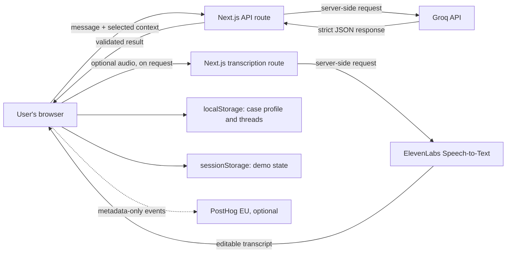

# Architecture

Metis is a small Next.js application with no user accounts and no central database. Its main architectural goal is to keep persistent case data on the user's device while sending only the context required for a requested AI analysis.

## System overview

## Trust boundaries

### Browser

The browser stores the case profile and conversation threads in `localStorage`. Demo state is stored in `sessionStorage`. This data is available only to the browser profile and origin that created it; it is not synchronized or backed up by Metis.

### Next.js server

`app/api/analyze/route.ts` and `app/api/evaluate/route.ts` are server-side boundaries. They assemble prompts, call Groq and return validated structured data. `GROQ_API_KEY` is read only on the server.

### Groq

Groq processes the message, selected case context, writing-style samples and up to three recent exchanges from the selected thread. The model is fixed in `lib/groq.ts` as `openai/gpt-oss-120b`.

### ElevenLabs speech-to-text

`app/api/transcribe/route.ts` accepts an audio file only after the user explicitly chooses to record or upload it. It sends the file to ElevenLabs Scribe (`scribe_v2`, with Polish selected) using the server-only `ELEVENLABS_API_KEY`, returns text for the user to edit, and does not store raw audio. A browser-local courtesy limit permits three recordings per calendar month and the UI limits recordings to three minutes. That client-side limit is not abuse-resistant.

### Analytics

PostHog is optional. Analytics events may contain interaction metadata but must never contain message content, case context, generated responses or replies marked as sent.

## Response contract

The model is instructed to return strict JSON. Schemas in `lib/groq-schemas.ts` constrain the response shape, while validators in `lib/analysis.ts` and `lib/evaluation.ts` protect the UI from malformed results.

The contract separates:

- risk classification and explanation,
- whether a reply is recommended,
- a factual summary of the incoming message,
- recommended stance and realistic options,
- attention points and phrases to avoid,
- questions for a lawyer,
- a proposed reply when the safety rules allow one.

All user-facing generated text is explicitly required to be in Polish. Technical enum values remain in English because they are part of the stable frontend contract.

## Product guardrails

- Metis does not claim to provide legal advice.
- High-risk cases can suppress the reply draft and surface questions for a lawyer.
- The prompt must not assume that the user is at fault or in a weaker position.
- Calm communication may still be firm, decline a request or maintain an existing arrangement.
- Gender and parental role must not change the risk threshold.
- Previous AI proposals are not treated as replies actually sent unless the user confirms them.

## Storage model

`lib/case-profile.ts` owns the versioned local case profile. `lib/message-history.ts` owns locally persisted threads and limits history to 300 analyses. Only the three most recent exchanges in the selected thread are sent as conversational context.

There is no cross-device synchronization. Clearing browser storage removes the local profile and history.

## Failure handling

The Groq client uses a 30-second timeout. It preserves HTTP 429 behavior and retry hints, and maps transient upstream failures to controlled server responses. The ElevenLabs client uses a 60-second timeout and maps rate limiting, timeouts and malformed responses to controlled Polish errors. Incoming-message analysis can use a manual prompt fallback when `USE_MANUAL_AI=true`; draft evaluation requires Groq.

## Repository structure

- `app/` — pages, shared UI and server API routes
- `lib/` — prompts, schemas, validation, storage and analytics
- `tests/` — synthetic contract and behavior tests
- `scripts/` — optional local evaluation tools
- `docs/product/` — current scope and durable product decisions
- `docs/design/` — visual language and design documentation

## Deployment

The reference deployment runs on Vercel. Required production secrets (`GROQ_API_KEY` and, for speech-to-text, `ELEVENLABS_API_KEY`) are configured in the hosting environment, not committed to Git. A fork can be deployed to any platform that supports the Next.js server runtime.
