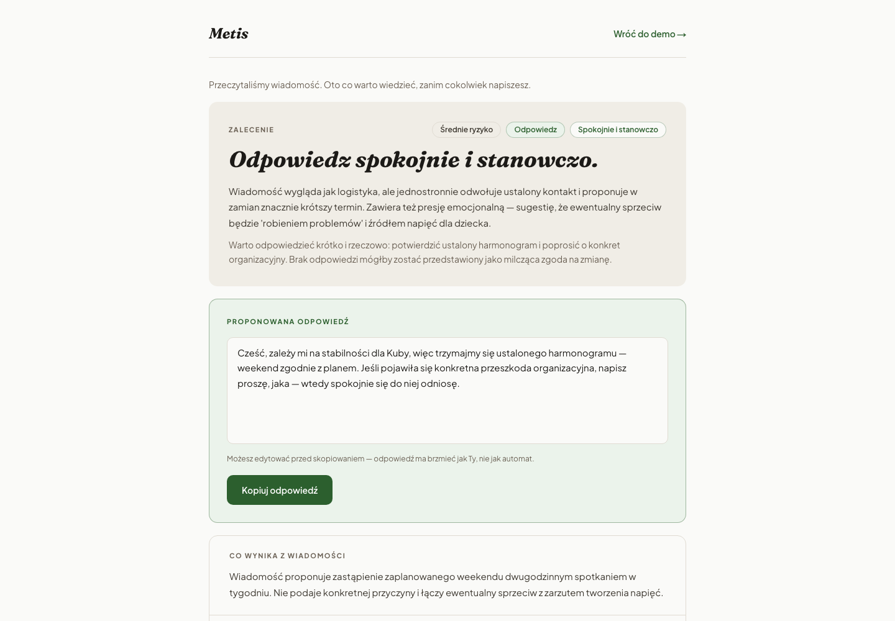
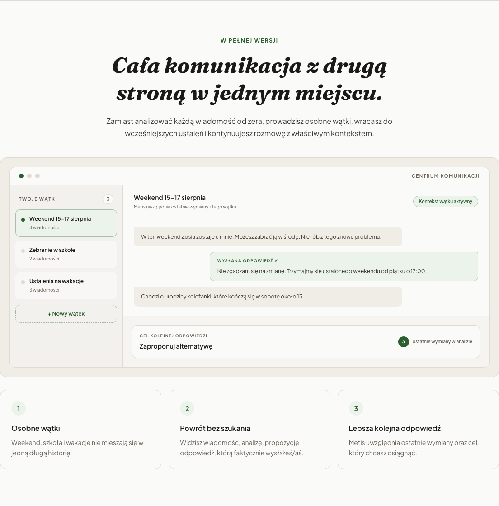

# Metis

Metis is an open-source communication assistant for people navigating high-conflict family disputes. It helps users inspect an incoming message, understand communication risks, and draft a calm but firm reply grounded in the context of their case.

The interface and generated responses are currently in Polish. Metis is a portfolio project and public demonstration, not an active commercial service.

**[Try the live demo](https://metis-pearl.vercel.app)**

> Metis provides organizational and writing assistance, not legal advice. It does not replace a lawyer or guarantee any legal outcome.

## What it demonstrates

- Structured analysis of incoming messages with risk levels and response options.
- Calm, firm reply drafting that does not confuse de-escalation with submission.
- A local case profile and writing-style samples used as stable context.
- Voice-to-text input for case context, received messages and the user's own draft. The user reviews and edits every transcript before it is used.
- Separate conversation threads with locally stored message history.
- Explicit confirmation of the reply that was actually sent.
- Sentence-by-sentence evaluation of a user's own draft.
- A high-risk boundary that redirects users to questions for a lawyer.
- Strict server-side structured output from Groq using `openai/gpt-oss-120b`.

## Screenshots

| Message analysis | Communication history |
|---|---|
|  |  |

## Privacy model

Metis has no user accounts or central case database.

- Case profiles and public-demo conversation history are stored in the browser.
- Demo context and results are limited to the current browser session.
- AI requests are sent through server-only Next.js API routes to Groq.
- `GROQ_API_KEY` is never exposed to the browser.
- Voice recordings are sent through a server-only route to ElevenLabs only when the user requests transcription. Metis does not store raw audio; see ElevenLabs' retention terms before using this feature with sensitive material.
- `ELEVENLABS_API_KEY` is never exposed to the browser.
- Message text, case context, generated output, and sent replies must never be included in analytics events.
- Browser storage is not a backup and does not synchronize between devices.

See [SECURITY.md](SECURITY.md) and [ARCHITECTURE.md](ARCHITECTURE.md) for the full technical boundaries.

## Local development

Requirements:

- Node.js 20.9 or newer
- npm
- a Groq API key for real AI analysis
- an ElevenLabs API key for optional voice-to-text input

```bash
git clone https://github.com/vesperolabs/metis-open_source.git
cd metis-open_source
cp .env.example .env.local
npm install
npm run dev
```

Open [http://localhost:3000](http://localhost:3000).

Set these values in `.env.local`:

```dotenv
GROQ_API_KEY=gsk_your_key_here
ELEVENLABS_API_KEY=your_elevenlabs_key_here
USE_MANUAL_AI=false
```

`NEXT_PUBLIC_POSTHOG_KEY` is optional. Leave it empty to run without analytics. Set `USE_MANUAL_AI=true` to return a copyable prompt instead of calling Groq for incoming-message analysis.

Vercel Web Analytics is included for anonymous page-view measurement on Vercel deployments. It does not require an environment variable.

Voice transcription uses ElevenLabs Scribe with Polish language selection. The browser enforces a courtesy limit of three recordings per month per device, with a three-minute maximum per recording. This is not a security-grade rate limit, so fork operators should set their own provider limits as well.

## Verification

```bash
npm test
npx tsc --noEmit
npm run build
```

The synthetic test suite contains no real case data. If you contribute new scenarios, use fictional names and facts only.

## Architecture

Metis uses Next.js App Router, React, TypeScript and Tailwind CSS. Server-side API routes call Groq with strict JSON schemas; a separate server-side route calls ElevenLabs for opt-in speech-to-text. The frontend validates and renders the same response contract. All product persistence uses browser storage.

Read [ARCHITECTURE.md](ARCHITECTURE.md) for the data flow, trust boundaries and project structure.

## Project status

Metis is maintained as a working portfolio demo. It is not being developed as an active business, does not accept payments and provides no service-level commitment. The public deployment may be changed or discontinued.

## Contributing and security

- [Contributing guide](CONTRIBUTING.md)
- [Security policy](SECURITY.md)
- [Code of conduct](CODE_OF_CONDUCT.md)
- [Product status](docs/product/current-status.md)
- [Product decisions](docs/product/product-decisions.md)
- [Design system](docs/design/design-system.md)

Please do not submit real messages, court documents, names, contact details or other case information in issues, pull requests, tests or screenshots.

## License

The source code is available under the [MIT License](LICENSE). “Metis” is the project name; the license does not grant rights to imply endorsement by the original author.
